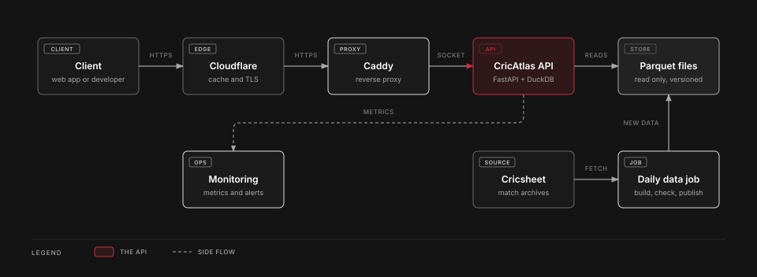

# 🏏 CricAtlas API

## Overview

A read-only API over ball-by-ball cricket data. Ask it for a match scorecard, a player's career, a team's record, a head-to-head or a leaderboard, and get clean JSON back. The data comes from [Cricsheet](https://cricsheet.org/), and the API runs live on one small server.

**Live API**: <https://cricatlas.ariadaikalam.com/api>
**Docs**: <https://cricatlas.ariadaikalam.com/api/docs>

> Statistics reflect the matches available in this Cricsheet snapshot and may not represent complete career records or official totals.

## The Project Involves

- **Cricsheet**: the source of every match. Its ball-by-ball downloads are rebuilt into clean tables.
- **Python + DuckDB**: the query engine. It reads the data files on each request.
- **FastAPI**: the server. Every route has a strict response model and an OpenAPI description.
- **Parquet**: how the data is stored. An export checks the tables first (row counts, keys, parent rows) and stamps them with a hash.
- **Docker Compose + Caddy**: how it is served, behind Cloudflare, on a hardened host that only Cloudflare can reach.
- **Prometheus, Grafana and Alertmanager**: private monitoring, with an email when something looks wrong.
- **pytest**: about 3,000 tests, including scorecards checked against real matches.
- **Claude (Sonnet 5.5, medium effort)**: did all of the implementation.
- **Codex (GPT-6.1 Sol, high effort)**: planned the project and made the decisions together with me, then reviewed each step for the code and for whether it met the requirements.
- **VibeSec Pro**: the security check ran on each step, from [vibesec.sh](https://vibesec.sh).

## What You Can Ask It

| Ask for | Example |
|---|---|
| Matches, newest first | `/v1/matches?team=India&limit=5` |
| A scorecard | `/v1/matches/{match_id}/scorecard` |
| A player and their career | `/v1/players?q=kohli`, then `/v1/players/{player_id}/batting` |
| A leaderboard | `/v1/leaderboards/batting?metric=runs&limit=3` |
| A team's record | `/v1/teams/record?team=India&gender=male` |
| Two teams head to head | `/v1/head-to-head?team=India&opponent=Australia&gender=male` |
| One batter against one bowler | `/v1/matchups?batter={player_id}&bowler={player_id}` |

Every route, with its parameters and errors, is in the [docs](https://cricatlas.ariadaikalam.com/api/docs).

## Why I Built It

I love cricket, and I wanted its ball-by-ball record behind a clean interface. I also wanted to run a small service the way a production one is run: one modest server, strict inputs, answers checked against real matches, monitoring, and a deploy that can be rolled back. CricAtlas, a web app, is built on this API.

## How It Works

<picture>
  <source media="(prefers-color-scheme: dark)" srcset="docs/diagrams/architecture-light.svg">
  
</picture>

A daily job checks Cricsheet and publishes new data only after the checks pass. The steps are in the [design decisions](docs/api_design.md#daily-publishing).

## Built To Be Careful

- **Strict inputs**: an unknown parameter is an error, and an error never shows a path, a query or a stack trace.
- **Checked against real matches**: scorecards are compared with published figures, and runs, balls, extras and wickets are counted a second way.
- **Fair use**: each client has a rate limit and one heavy request at a time, so a busy moment slows people down instead of breaking the server.
- **Safe publishing**: new data is validated before it goes live, and the old data stays live if anything fails.
- **Private monitoring**: dashboards and alerts sit on a private network, not on the public internet.

## How Fast

On the one 2 vCPU server it runs on, a 48 hour test sent 586,357 requests (about 3.4 a second) and every one answered 200. The 99th percentile for each 10 minute phase had a median of about 125 ms for light routes, 107 ms for medium and 240 ms for heavy. The traffic was synthetic, and this is not a measure of maximum capacity. The method, the memory behaviour and the limits that were found are in the [measured results](docs/measured_results.md).

## Coverage And Limits

CricAtlas calculates statistics from the matches included in its Cricsheet snapshot. Cricsheet does not provide every cricket match, and some matches are withheld or unavailable. Consequently, runs, wickets, appearances, centuries and other totals may differ from official career statistics. A missing match is absent data, not a zero-performance result. Use `/v1/meta` to check the snapshot date and version.

Cricsheet withholds all Afghanistan men's matches and the Afghanistan Premier League, so a player's or a team's totals can be short in a way the data cannot show.

## Run It Yourself

You need Python 3.11 or newer. The repository carries a small cut of real matches, so this works from a fresh clone:

```
pip install -e ".[serve]"
CRICKET_API_DATA=tests/golden/api CRICKET_API_SECRET=<a long random string> python -m cricket_api
curl "http://127.0.0.1:8000/v1/matches?limit=2"
```

To run the tests:

```
pip install -e ".[dev]"
python -m pytest
```

## Documentation

- **[Design decisions](docs/api_design.md)**: what it serves, how it is built, and why.
- **[Technical reference](docs/reference.md)**: settings, every route, limits and caching.
- **[Measured results](docs/measured_results.md)**: the load tests and what they showed.

## Data Source

- **Ball-by-ball and match data**: [Cricsheet](https://cricsheet.org/), released under the [Open Data Commons Attribution License 1.0](https://opendatacommons.org/licenses/by/1-0/). Contains data from Cricsheet, used with attribution.

## License

The code is released under the MIT License, see the [LICENSE](LICENSE) file. The data keeps its own licence, above.

## Contact

Developed and maintained by Ari Adaikalam. [Portfolio](https://ariadaikalam.com) | [Email](mailto:ariadaikalam1234@gmail.com)

Bug reports, data discrepancies and suggestions are welcome. For a bug, please give the endpoint, the parameters and the request ID (every error carries a `request_id`). Please never send credentials.
