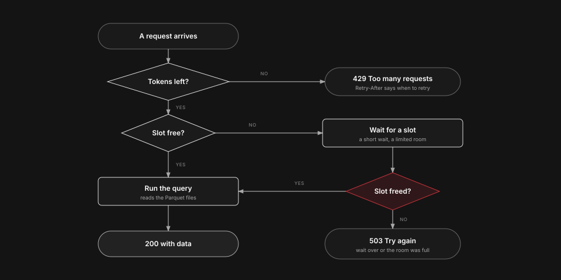
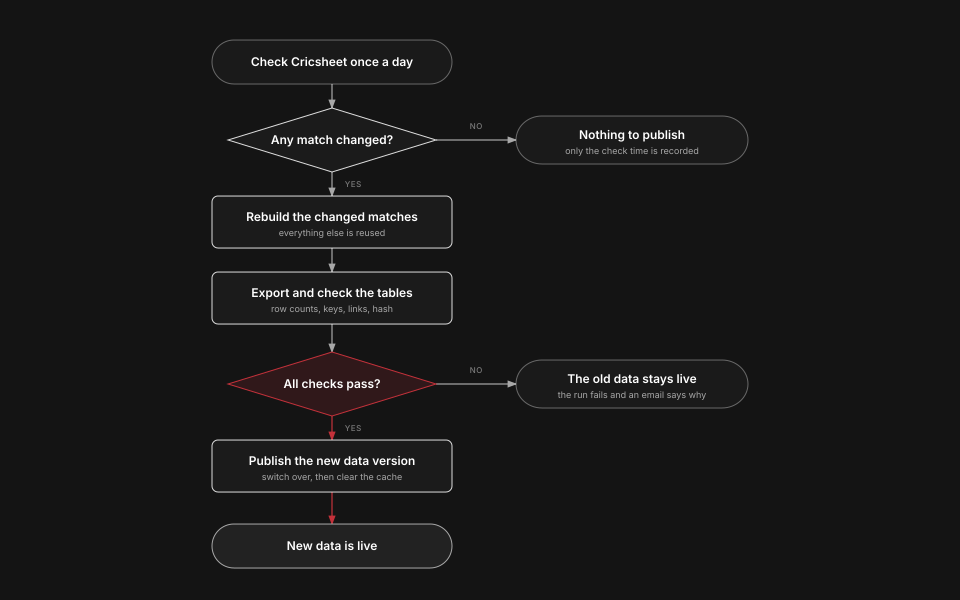

# API design

The current design of the CricAtlas API: what it serves, how it is built, the decisions behind it, its security constraints and the deployment it runs in. It describes what is built and live. How it is deployed is described below and in `deploy/README.md`, and what was measured is in [measured_results.md](measured_results.md). The plans, audits and gate records this page replaces are kept in the private repository's git history.

## Purpose

A public, read-only HTTP API over the Cricsheet-based data, at `https://cricatlas.ariadaikalam.com/api`. It is a portfolio piece that shows careful API engineering, and a free way for developers to query the data. CricAtlas, a web app, is built on the same data.

## Scope and decisions

- **What it serves.** The Cricsheet columns of the ball file, the player facts on each ball (country, styles, role, age), the match table, and a player list with an id and a name. The player columns are plain facts that stay with the ball file (owner, 2026-10-10).
- **Never served.** The tracking, prediction and coverage files, `cricinfo_id`, image addresses and the rest of the player file. A test fails the build if a banned name appears in a table, a response model, a documented example or a response.
- **Where the code lives.** In `` of the internal repo, not a new one. It is exported to its own public repo the way the dataset is, and the dataset's public export leaves `` out.
- **Where the data comes from.** The API's refresh is self-contained. It builds its own data from its own inputs under `data/` (the Cricsheet archives, and a player-profile snapshot) and does not use the dataset pipeline in the repository root or read the root `data/` folder. The profile snapshot is copied in separately by a small local script that is not part of this repository. `python -m cricket_api.export` reads the CSV files in `data/csv`, keeps only the columns in `cricket_api/contract.py`, writes the Parquet files and `meta.json` under `data/exports`, and moves them into place only after row counts, filled cells, keys and links match the CSV files. The Mac-side refresh runs the export as one of its steps, and deploying is separate and manual. The VPS also refreshes the data daily by itself, from preparation through validation to publication and the cache purge (see `refresh_workflow.md`).
- **Hosting.** One small virtual server (2 vCPU, 4 GB, 40 GB NVMe, monthly, no commitment). The path is Cloudflare Free, then Caddy, then the API. Cloudflare cache rules come first, and there is no Worker without a measured need. The Parquet files live on the server and are mounted read-only, so the code and the data are released as a matched pair.
- **Why this host.** It costs about a third of a comparable Sydney plan for the same vCPU and memory. The costs are the Singapore location (further from Australian users, offset by the cache), a 500 GB monthly traffic allowance and a smaller disk. Hugging Face Spaces, Hetzner, Render, Koyeb and Google Cloud Run were ruled out on price, size, sleeping or billing rules.
- **Cricket rules the summaries follow,** written once in shared code and tested against known scorecards: runs charged to a bowler include wides and no balls but not byes and leg byes. Wickets credited to a bowler exclude run outs and retirements. Balls bowled and faced use `is_legal_delivery`, so a wide is not a ball faced and a no ball is.
- **Statistics are not official totals.** The documentation page carries the maintainer's wording (Overview and Coverage).

## Stack

- FastAPI, DuckDB reading the API's Parquet files, Pydantic models for every request and response.
- One worker process, because the rate limiter keeps its state in memory. Several workers would each allow the full limit. The launcher (`python -m cricket_api`) is the supported start and fixes one worker, uvicorn's forwarding header handling off and no Server header.
- Pinned dependencies with a lock file, pip-audit in CI, a container that runs as a non-root user with a read-only file system and the data mounted read-only. No secret is baked into the image.

## Versioning and meta

- Every business route lives under `/v1`: the lookups, matches, players, teams, leaderboards, matchups and `/v1/meta`. `/health`, `/status`, `/openapi.json` and the `/docs` page are operational routes and are not versioned. A breaking change to a business route gets `/v2`, and `/v1` keeps working for a stated period.
- `GET /v1/meta` returns the data version, the data date, row counts and the source credit (Cricsheet, ODC-By 1.0). It reads the `meta.json` the export writes. The data is Dataset v3, version `2a3579eb5b8f` since 2026-10-28 (`5fc42bc763cd` before), 22 tables.
- `GET /health` is liveness only. `GET /status` returns the data version, the data build time, the snapshot date, the start time and the request, client error, server error and rate-limited counts. It says nothing about the host, paths, library versions, file names or the limiter's occupancy.

## Routes

`docs/reference.md` lists every route, and each has its tests in `tests`. `test_route_inventory.py` fails when a route lacks any of the standard safeguards: a typed response model, a saved response, documented problem details, independent real-data checks, leak and injection requests, and documentation.

- **Lookups:** competitions, teams (one entry for each team and gender), venues, players, and a keyword search with `q` on `/v1/matches` and `/v1/competitions`.
- **Matches:** the list, one match, its scorecard (`actual_overs` and `scorecard_overs`, absent hurt players, maidens by the umpires' count), its balls, and its powerplays, reviews, replacements, wickets and notes.
- **Players:** the profile, career batting, bowling and fielding, the same by season and by opponent, venue, competition and format (`/splits`), the match history, and `/v1/matchups` for one batter against one bowler. `metrics.py` holds the totals and rates, and a rate is always made from summed numerators and denominators.
- **Teams:** records and head-to-head. Gender is required, results come from the match table only, ties are kept apart from eliminator outcomes, and coverage is labelled as this dataset.
- **Leaderboards** for batting and bowling. Thresholds are judged after the filters and echoed back, ranking uses unrounded ratios, and ties are broken deterministically. The bowling defaults are 300 balls, and 10 wickets for average and strike rate.
- There is no free-form aggregate route. Every grouping is its own route over a fixed set of dimensions, so the dimensions, the metrics and the sorting stay allow-listed and the result sizes stay bounded.

Career, seasons, splits, history, matchups, scorecards and leaderboards read small derived tables (`player_batting_innings`, `player_bowling_spells`, `player_fielding_events`, `player_match_involvement`, `batter_bowler_innings`, `match_scorecards`) built at export and checked against their definitions, so a table that disagrees makes the export refuse the data.

## Filters and metrics

- Filters: format, competition, season or date range, gender, team, venue, innings, over range, batter, bowler, outcome and dismissal type. Phases (powerplay, middle, death) are computed from the over number.
- Every filter is validated against an enum or a range. An unknown parameter returns 400 and is never silently ignored, which also stops a random extra parameter from defeating the cache.
- Each metric (strike rate, average, economy, dot ball percentage, boundary percentage) has one definition in one metrics module, used by the API and tested against known scorecards.

## Pagination

Cursor based, using the delivery key as the keyset, never OFFSET. `limit` defaults to 50 and is capped at 500, and lower for raw balls. The response carries `next_cursor`, or null at the end. Cursors are opaque, signed, hold only keyset values, are validated again on use (including their types), and are bound to the data version, so a cursor from an older data version is rejected with a clear error. The signing secret has a minimum length.

## Rate limiting and admission

- **Rate limit.** A token bucket per client, 60 tokens a minute with a burst of 20 (`CRICKET_API_RATE`, `CRICKET_API_BURST`). The client is identified by its address (behind Caddy, the address Caddy passes on, see Client identity below), with IPv6 grouped by /64. There are no API keys and no accounts. A limited request gets 429 with `Retry-After`, and responses carry `RateLimit-Limit`, `RateLimit-Remaining` and `RateLimit-Reset`. A 429 is never cached.
- **Token costs** follow the measured CPU of each route (`cost_for` in `app.py`). A leaderboard costs 5, the scorecard, the ball pages and the other heavy routes 3, a player's match history and matchups 2, and everything else 1, including a player's batting, bowling and fielding career, seasons and splits. `/health` costs nothing.
- **Client identity.** The API's immediate peer is Caddy, not Cloudflare. Caddy checks that the request came from Cloudflare, works out the client address, deletes every client-supplied forwarding header and sends one header it owns. The API trusts only the exact Caddy peer or the protected Unix socket, reads that header, and otherwise uses the socket address. A forwarding header is never read from the left of a list.
- **The limiter's table is bounded**, with expiry of idle entries and a hard size limit (`CRICKET_API_MAX_CLIENTS`, 10,000), so many addresses cannot grow memory or flush other clients' entries.
- **Bounded admission** (`cricket_api/admission.py`). A request that needs the database is admitted before it uses a thread, into one of three classes inside one total number of units (`CRICKET_API_CONCURRENCY`, 3 to 32, default 4): light (most routes), medium (the scorecard, a player's career, seasons, splits and history, and matchups) and heavy (the leaderboards). At most units minus 2 heavy requests run at once, and at most units minus 1 heavy and medium together, so one unit is never used by heavy or medium work and light routes are never shut out. A request that cannot start waits without a thread in a room of fixed size for a fixed time, and a full room refuses at once. The defaults are room 4 and wait 1.0 s for heavy, room 8 and wait 1.5 s for medium, and room 32 and wait 1.5 s for light. A client may have one heavy request running or waiting. A refusal is a 503 with `Retry-After` (1, 2 or 5 seconds by class). Capacity is released only when the database work has finished, whatever happens to the awaiting coroutine. Routes that use no database are not admitted at all.
- **Time limits.** A request has 10 seconds in all (`CRICKET_API_REQUEST_SECONDS`) and each query about 5 (`CRICKET_API_QUERY_SECONDS`). The per-query limit is enforced by interrupting the database connection from a timer. The request budget is separate: a query is never given more time than the request has left, and none starts once the budget is spent or the client has gone, and the budget is rechecked after the database slot is taken. A watcher notices a client disconnect by reading the request's `receive` channel (safe because no route reads the body, and a streaming route would need a second look) and abandons the budget. That stops queries that have not started. It does not stop the query or the worker thread that is already running: that ends when the query finishes or reaches its own time limit, and the admission unit is held until the thread ends.
- The server's own limit of about 100 connections (`limit_concurrency`) answers a plain 503 before the application runs, and `/health` shares it.

### The path of a request

<picture>
  <source media="(prefers-color-scheme: dark)" srcset="diagrams/request-light.svg">
  
</picture>

## Errors

- RFC 9457 problem details (`application/problem+json`) with `type`, `title`, `status`, `detail`, `instance` and a `request_id`.
- No stack traces, paths, SQL, library names or versions. Debug mode is off in production. Echoed request text is length-capped and never used to build markup. A 500 is logged with the request id and, for known database faults, a fixed sentence chosen by exception type alone. The exception's message is never logged.
- Unknown routes and unknown ids return the same 404. A bad parameter returns 400 naming the parameter.
- Only GET and OPTIONS exist (HEAD is not served). Other methods return 405 and a request body is rejected (413). Errors are sent with `Cache-Control: no-store`. There are no trailing slash redirects, and the same CORS headers are sent on every response.

## Query safety

The most important part, because DuckDB can read files and load extensions unless told not to.

- DuckDB runs in memory over the Parquet files. At startup the code creates views over the allow-listed files, limits file access to the data folder, turns off external access, extension autoloading and installing, sets a memory limit and a thread limit (two threads), and locks the configuration so a query cannot change it.
- These settings are not read-only enforcement. Inside the data folder a statement could still read other files or write a new one (checked by hand on a copy of the data on 2026-10-11), and an in-memory table can be created. Nothing can send such a statement, because there is no caller-supplied SQL. The deployment closes the gap with a read-only data mount, a read-only code mount, a non-root user, and a small size-limited writable scratch volume. Request text never reaches `read_csv`, `read_parquet`, `COPY`, `ATTACH`, `INSTALL` or `LOAD`.
- No free-form SQL. All values are bound parameters, and a list filter expands to one parameter per value within a cap.
- Sort fields, group-by dimensions and metrics are looked up in allow-lists that map a public name to a fixed SQL fragment written in the code. Sort direction is only ASC or DESC.
- Search text is normalised (Unicode NFKC), length-limited, and has `%`, `_` and the escape character escaped before a `LIKE`. No user regular expressions. Ids are validated by shape before a query runs. File paths never come from a request.
- Results are row-capped and the response says when truncated. Request size, URL length and list sizes are capped.

## Caching

- Responses carry an `ETag` made from the response bytes and the data version, so it changes when the data does and when anything in the request changes the answer, and `Cache-Control: public, max-age=...` from one policy table in `cricket_api/caching.py`: match routes 1 day, computed and reference routes 1 hour, and `/health`, `/status`, errors and refusals no-store. A conditional request returns 304 (with `*`, lists and weak comparison).
- A shared cache keys on the full URL including its query string. Nothing about a client changes a body, so a shared cache cannot serve one client's data to another. In shared cache mode (`CRICKET_API_SHARED_CACHE`) a cacheable answer carries no `RateLimit-*`, `X-Request-ID` or `X-Response-Time-Ms`.
- A new data version changes every ETag but does not evict a browser or CDN entry that is still fresh, which can serve the old answer for up to an hour (a day for match routes). A deploy therefore purges the Cloudflare cache for the API hostname only, never the whole zone. Browser copies expire on their own.
- The documentation page (`/docs`) is sent with `Cache-Control: public, max-age=3600, no-transform`. `no-transform` stops Cloudflare injecting its analytics script, which the page's policy would block. Only `/docs` carries it.

## Security

- Read-only, no accounts, no cookies, no personal data and no outbound requests, so CSRF does not apply and there is no SSRF surface. A change that adds an outbound call needs its own review.
- CORS: GET and OPTIONS from any origin, because the data is public, and never `Access-Control-Allow-Credentials`.
- Headers on API responses: `X-Content-Type-Options: nosniff`, `Strict-Transport-Security`, `Referrer-Policy: no-referrer`, `Content-Security-Policy: default-src 'none'; frame-ancestors 'none'`. Server name and version headers are removed.
- The documentation page has its own policy: `default-src 'none'; style-src 'self'; img-src 'self'; font-src 'self'; base-uri 'none'; form-action 'none'; frame-ancestors 'none'`. It runs no script and loads nothing from another origin. The monitoring portal carries the same policy.
- There are no API keys, accounts or credentials of any kind for a caller to send.
- At start the server checks the Parquet files against the SHA-256 values in `meta.json` and refuses to start on a mismatch.
- **HSTS.** The API sends `Strict-Transport-Security: max-age=<seconds>; includeSubDomains` with the seconds from `CRICKET_API_HSTS_MAX_AGE` (default 31536000, from 0 to two years, anything else stops the start). `includeSubDomains` applies to that host and any name under it. It does not touch ariadaikalam.com, the web app's host or any sibling host, and nothing sits under the API host. `preload` is never sent: an entry cannot easily be undone, a removal takes months to reach users, other browsers are not guaranteed to follow, and the requirements are a promise this API has no need to make. Cloudflare's own HSTS setting stays off. The rollout starts at `CRICKET_API_HSTS_MAX_AGE=86400` and rises to the default once the host and its certificate renewal have behaved. `CRICKET_API_HSTS_MAX_AGE=0` sends `max-age=0`, which makes a browser remove the policy it stored for this host name (RFC 6797 sections 6.1.1 and 8.1; `includeSubDomains` is ignored in that response) only after a valid HTTPS response, with no certificate errors, reaches that browser. It cannot override a policy that applies from a parent domain with `includeSubDomains`, and it does not guarantee removal from a browser's preload list. After any change, purge the Cloudflare cache. The live value on 2026-10-17 is `max-age=86400; includeSubDomains`, read through Cloudflare by `public_smoke.sh` on a normal response, a 404 and a 304. The one-year value has not been set.

## Deployment architecture

Operations are described in private runbooks. This is what the deployment is made of and why, without the details of how the host is protected.

- **Chain.** Cloudflare in front, then a reverse proxy (Caddy), then the API over a Unix socket that only the service users can reach. The origin accepts traffic only when it has come through Cloudflare, and a request sent straight to the origin address is refused. A check after every deploy confirms that.
- **Containers.** One Docker Compose project: the proxy, the API, the notifier, and the monitoring stack (Prometheus, Alertmanager, node-exporter and Grafana). Only the proxy publishes a port to the internet. Every container has a hard memory limit, and the API container is capped at 2,200 MiB. The test for the whole host is available memory, which must stay at or above 600 MiB.
- **Scratch.** DuckDB spills to a fixed-size ext4 volume (2 GB, DuckDB's cap 1 GiB, `CRICKET_API_SCRATCH` and `CRICKET_API_SCRATCH_MAX`) mounted `nosuid,nodev,noexec`, chosen over tmpfs so that a full scratch fails one query with a clean 5xx and does not kill the process. A small tmpfs serves `/tmp`.
- **Fault log limit.** A fault storm could push days of logs out of a capped journal, so the process writes at most 20 detailed entries in any 60 seconds, as a sliding window on a monotonic clock shared by the whole process, with a small fixed state that no request can grow. A fault past the limit is counted in `cricket_api_fault_log_suppressed_total` and its entry is not written. The first of a run writes one notice, and the run ends with one summary scheduled for 60 seconds after it began (a schedule and not a deadline). The counts are exact in the process and in the integer text, with no cap, and the Prometheus value is a 64-bit float with precision up to 2^53. The limit is fixed in the code and fails open: if the limiter itself fails, the entry is written. The I/O diagnostic for `duckdb.IOException` is "A file operation of the query engine failed, whether reading a data file, writing, or using the scratch folder." It is chosen by exception type alone.
- **Monitoring.** Prometheus (15 days, 1.5 GB), Alertmanager, node-exporter and a provisioned, read-only Grafana dashboard. Alerts go through the notifier and an email service to the maintainer, with one daily summary at 9 PM Australia/Sydney. The notifier's design is in `notifier/README.md`.
- **Private access.** Grafana, Prometheus, Alertmanager and a landing page are reachable only over a private network (Tailscale). None of them is on the public internet. Routine operations use that network only, and a console from the hosting provider remains as the way back in if it fails.
- **Releases.** A release is an immutable folder (images, a config bundle, the data) identified by the date, the commit and the data version, deployed by hash-verified push and rolled back by name. The data folder is reused on the host.

## Daily publishing

<picture>
  <source media="(prefers-color-scheme: dark)" srcset="diagrams/publishing-light.svg">
  
</picture>

A run that finds nothing new records only the time of the check. A run that fails a check publishes nothing, and an email says why.

## Boundary

The contract (`cricket_api/contract.py`) lists the columns. Three layers hold it:

1. The export writes only those columns, so the files hold nothing else.
2. The server reads only those files, and its response models list their fields explicitly. No `SELECT *`, and no model accepts extra fields.
3. A test fails the build if a banned column name appears in the Parquet schema, a response model, a documented example or a response from any route.

## Source and licence

The data is Cricsheet's, under ODC-By 1.0, which requires attribution. The API states it everywhere a client or reader will look: `GET /v1/meta` returns `source`, `source_url`, `licence`, `licence_url` and the attribution sentence. Every response carries `Link: <licence url>; rel="license"` and a short `X-Attribution` header, and a data response also carries a compact `source` field in its envelope. The OpenAPI document sets `info.license` and an attribution paragraph, and the docs page shows it in its header and footer.

## Switches

The dataset has two independent choices: whether match capture is used (tracking, predictions, coverage) and whether player profiles are fetched (country, styles, role and age on the ball rows, and the profile columns of `players.csv`). The API does not hard-code either. The export writes the columns that exist into `meta.json` (`features`: `player_profiles`), and the server builds its models, OpenAPI and docs from that, so a deployment without profiles has no profile fields and says so. The contract lists the profile columns as an optional group.

## Observability and documentation

- Error logs carry the request id and a fixed diagnosis chosen by exception type, never the exception's text, a key or a request body (a canary in the exception text is tested never to appear).
- OpenAPI is generated from the Pydantic models, with an example for every route. The `/docs` page is made from it and from the guide, runs no script, and reads the numbers it quotes (limits, costs, thresholds) from the running server. The values it shows are checked against the API by the tests.

## Testing

- Unit tests for every metric and filter rule, contract tests of responses against the OpenAPI schema, and the boundary test above.
- Abuse tests: injection strings in every parameter, wildcard searches, oversized lists and URLs, an unknown parameter, a forged forwarding header, a flood of distinct addresses with memory staying bounded, a query that hits the time limit, and a query that tries to read a file or load an extension.
- A 429 and an error response are never cacheable, and a stale cursor is rejected. Tests for the bucket, the cost weights, the headers and the 429 body.
- Deployment tests (Docker needed, kept in the private repository) for the host scripts, the firewall, Caddy's headers and the monitoring configuration. Load and soak tools are in `loadtest/`, and their measurements are in `measured_results.md`.

## Security findings and their dispositions

A local audit on 2026-10-10 found 13 items. The probe scripts that reproduced them were archived with the audit and are in git history.

| # | Finding | Disposition |
|---|---|---|
| 1 | `CF-Connecting-IP` was trusted without validation | Fixed: client identity rules (see Rate limiting and admission) |
| 2 | Over a Unix socket every visitor shared one bucket | Fixed with finding 1 |
| 3 | Heavy routes could starve cheap database routes | Fixed: bounded admission |
| 4 | The limiter table could be flushed, and IPv6 was not grouped | Fixed: bounded table, /64 grouping, the packaged launcher |
| 5 | A 500 left no log entry | Fixed: sanitized error logging |
| 6 | A validly signed cursor was not type checked | Fixed |
| 7 | A weak cursor secret was accepted | Fixed: minimum length |
| 8 | The Host header was copied into trailing slash redirects | Fixed: no redirects |
| 9 | CORS headers appeared only when a request had an `Origin` | Fixed: the same headers on every response |
| 10 | `/status` showed limiter occupancy to anyone | Fixed: `tracked_clients` removed from `/status`, its model and the OpenAPI document |
| 11 | The database connection can still create in-memory tables | Accepted limitation under the present design. The connection reads the approved data files with restricted external access, disabled extensions and locked configuration. Non-root execution and read-only code and data mounts are deployment requirements. The connection was not changed. |
| 12 | HSTS uses `includeSubDomains` | A deployment decision. Not resolved: the header is unchanged, the live value is `max-age=86400`, and the one-year value is not set (see HSTS above). |
| 13 | Some refusals are not rate limited and some work repeats per page | Documented as bounded limitations. The 405, 413 and `OPTIONS` answers are cheap and not rate limited, the splits routes recompute every group on each page (since the derived tables, a player's batting, bowling and fielding splits cost 1 token and the team splits 3), `/v1/competitions` is one unpaged answer of about 228 KB, and the API does not compress. Edge traffic limits and compression have to be verified on the deployment. |

Checked and sound in the audit: all SQL values bound and every identifier from an allow list or a typed enum; a fuzz of every route and parameter with 35 hostile values (6,205 requests); request framing and smuggling cases (a body with a conflicting length header gave 413, a duplicate `Host` gave 400, a method override header is ignored, and every method but GET and OPTIONS gave 405); the rate-limit cost of eleven path variants; slow-regex attempts on `If-None-Match`; cursor HMACs compared in constant time and bound to the route and the data version; a documentation page that escapes everything; and no secrets in the tree.

## Known limits

The measured limits, the accepted `/health` behaviour under a connection flood and the memory behaviour under continuous traffic are in [measured_results.md](measured_results.md). They are not repeated here.

## Non-goals

Write endpoints, user accounts, live scores, any source other than the published ball file and the match table, and commercial use or paid tiers.
