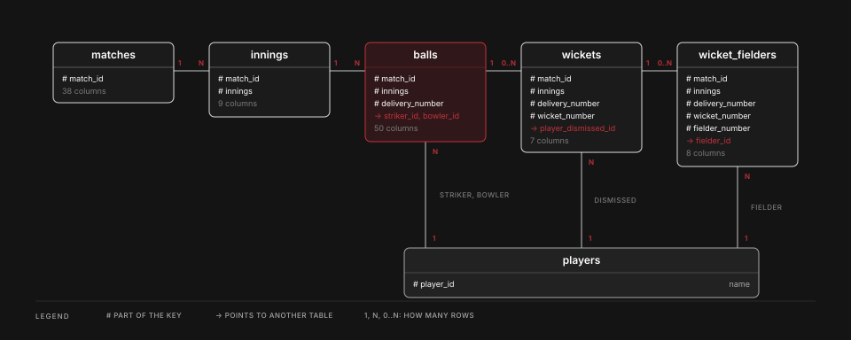

# CricAtlas API reference

How the API is built, every route, its limits, and how it is tested. The short version is in the [README](../README.md).

## What it serves

The API serves the same columns as the published ball file (`ball_by_ball_data.csv`), the match table (`matches.csv`) and a player list with an id and a name. It does not serve the tracking, prediction or coverage files, or any profile id or image address.

`cricket_api/contract.py` is the one place that lists the allowed columns. The export writes only those columns, so the Parquet files cannot hold anything else, and the server reads only the Parquet files. A test fails if a banned column name reaches a table.

### The core tables

<picture>
  <source media="(prefers-color-scheme: dark)" srcset="diagrams/tables-light.svg">
  
</picture>

Join on ids, never on names. There are 22 tables in all, and these six hold the core of the ball-by-ball record.

## Layout

```
cricket_api/      the server, the export, the documentation page
  contract.py     allowed columns, types, keys, sort order and links
  export.py       CSV files in, Parquet files out, with checks
  models.py       the shape of every response
  openapi.py      the error responses and media types in the OpenAPI document
refresh/          the daily data job: download, build, validate, publish
notifier/         email alerts and a daily summary
deploy/           Docker Compose, Caddy, monitoring and the host scripts
loadtest/         the load and validation tools
tests/            the API and refresh tests
  golden/         real matches cut from the full data, with the script that cuts them
pyproject.toml
```

## Documentation

The server documents itself at `/docs`: a guide, worked examples, and a reference for every route made from the OpenAPI document at `/openapi.json`. The page runs no script and loads nothing from outside, and its stylesheet is served by the API too. It has its own security policy, separate from the one the data routes carry. Set `CRICKET_API_DOCS=0` to leave it out.

The examples are real requests checked against a fixed test snapshot. They illustrate the contract, not live statistics; a newer snapshot may return different values. Coverage dates, counts, available formats and seasons come from the loaded tables. The guide's limits, costs, rate limits and thresholds come from the running server.

`/v1/meta` is the source for the served data version, row counts and coverage. `/freshness` adds separately recorded source-check and activation times and is never cached. An unknown time is null, not an inferred success. The documentation page shows the same facts. Do not copy live counts into this README or the web app; link to these endpoints or read them there.

## Freshness

A daily job on the server checks Cricsheet, builds the data, validates it and publishes it when a source file changed. When nothing changed it publishes nothing and records only the time of the check. The first scheduled run completed on 2026-10-30. A new Cricsheet match can take a day or more to appear, because it depends on when Cricsheet publishes it.

`/freshness` shows three separate times: the last successful source check, the last activation of new data, and the latest match date in the data. An unchanged check moves only the first of them.

## Write the data files

From this folder:

```
python -m cricket_api.export --source <folder with the CSV files> --out <folder for the Parquet files>
```

It reads the CSV files in the `--source` folder (the code in `refresh/` builds them from Cricsheet's archives) and writes the Parquet tables and `meta.json` to the `--out` folder. The files are built in a scratch folder and checked against the CSV files: row counts, filled cells per column, unique keys, and that every match, striker and bowler id has its parent row. They move into place only if every check passes, so a failed run leaves the last good files as they were.

`meta.json` carries a `data_version`, a short hash that changes only when a data file does. A cache can use it as a key.

The balls file is sorted by match, innings and delivery. A query for one match reads a few blocks of the file and skips the rest.

## Run the server

```
pip install -e ".[serve]"
CRICKET_API_SECRET=<a long random string> python -m cricket_api
```

`python -m cricket_api` (or the `cricket-api` command) is the supported way to start the server. It runs uvicorn with one worker, with uvicorn's own forwarding header handling off and with no Server header, and it offers no option that changes them. The rate limiter keeps its state in process memory, so more workers would each allow the full limit. The API reads forwarding headers itself, under the rules in Client identity below, and uvicorn's own handling would rewrite the connection address before the API saw it. Do not start the API with `uvicorn cricket_api.main:app` directly.

| Option | Meaning |
|---|---|
| `--host`, `--port` | Where to listen. The default is `127.0.0.1` and port 8000. Any address that is not loopback also needs `--allow-non-loopback`, because the API expects a proxy or a firewall in front of it |
| `--uds PATH` | Listen on a unix socket instead. Needs `CRICKET_API_CLIENT_IP=proxy` and `CRICKET_API_TRUSTED_PROXIES=unix`, and the launcher refuses to start without them |
| `--no-access-log` | Do not write a log line for every request |

A setting that cannot work stops the start with a message and exit code 2. The server reads the Parquet files in the folder `CRICKET_API_DATA` names. At start it checks every file against the hash in `meta.json` and refuses to run on a mismatch.

| Setting | Default | Meaning |
|---|---|---|
| `CRICKET_API_DATA` | `api/data/exports/current` (production sets `/data` in the Compose file; the tests use `tests/golden/api`) | Folder with the Parquet files and `meta.json` |
| `CRICKET_API_REFRESH_STATUS` | unset | Optional read-only JSON record of refresh checks. Mount its parent directory read-only so atomic file replacement is visible. It holds no credentials. Without it, check/activation times are unavailable. |
| `CRICKET_API_SECRET` | random at start | Signs pagination cursors. If it is set it must be at least 32 characters, and the server refuses to start with a shorter one or an empty one (it is not replaced by a random one, and the message never prints it). Leave it unset for a random secret that lasts until a restart, or set one so cursors survive a restart. See Secrets |
| `CRICKET_API_MEMORY`, `CRICKET_API_THREADS` | 1GB, 2 | Limits on the query engine |
| `CRICKET_API_HSTS_MAX_AGE` | 31536000 | The `max-age` of the `Strict-Transport-Security` header, in seconds, from 0 to 63072000 (two years). A whole number with no sign and no leading zero. 0 is allowed on purpose, to switch HSTS off again (see Deployment requirements and known limits). Anything else stops the start |
| `CRICKET_API_SCRATCH` | unset | A folder the query engine may spill to when a query needs more than its memory limit. It must be absolute, exist, be writable and be apart from the data folder, or the server refuses to start. Unset, the engine uses its own folder (`.tmp` in the working directory) |
| `CRICKET_API_SCRATCH_MAX` | 1GiB | The most the engine may keep in that folder, from 64MiB to 100GiB inclusive (GB is 10^9 and GiB is 2^30, as in DuckDB). It is read with whole-number arithmetic from at most 32 characters, a size that is not a whole number of bytes is rounded down, and anything malformed, too long or out of range stops the start. It applies whether or not a folder is set. With a folder set it must be at most 80 percent of the size of the filesystem the folder is on |
| `CRICKET_API_QUERY_SECONDS` | 5 | A query running longer is stopped |
| `CRICKET_API_REQUEST_SECONDS` | 10 | The whole request, all its queries together: a query gets only the time left, and none starts after it or after the client has left (5 to 60, never below the query limit) |
| `CRICKET_API_CONCURRENCY` | 4 | Units: how many requests run database work at once, from 3 to 32. The reserve for light routes needs at least 3, and the thread pool is sized from it (units plus 8) |
| `CRICKET_API_QUEUE_SECONDS` | 1.5 | How long a query waits for a database slot. With admission it is a backstop that should never be reached |
| `CRICKET_API_HEAVY_ROOM`, `_MEDIUM_ROOM`, `_LIGHT_ROOM` | 4, 8, 32 | How many requests of each class may wait for a unit. A full room refuses at once. 0 to 1000 |
| `CRICKET_API_HEAVY_WAIT`, `_MEDIUM_WAIT`, `_LIGHT_WAIT` | 1.0, 1.5, 1.5 | The longest a request waits, in seconds, from 0 to 60 |
| `CRICKET_API_MAX_CONNECTIONS` | 100 | The launcher's limit on connections, from the units plus the three rooms plus 8 (56 at the defaults) to 10000. If the rooms need more than 100 the default rises to match |
| `CRICKET_API_RATE`, `CRICKET_API_BURST` | 60, 20 | Requests a minute and burst for each client |
| `CRICKET_API_CLIENT_IP` | `peer` | `peer` or `proxy`, see Client identity |
| `CRICKET_API_TRUSTED_PROXIES` | none | Proxy mode only. The addresses or networks of the proxies the server may believe, and `unix` for a unix socket |
| `CRICKET_API_CLIENT_IP_HEADER` | `X-Forwarded-For` | Proxy mode only. The header that carries the client address |
| `CRICKET_API_IPV6_PREFIX` | 64 | How many leading bits identify one IPv6 client, from 32 to 128 |
| `CRICKET_API_MAX_CLIENTS` | 10000 | How many clients the limiter tracks at once |
| `CRICKET_API_SHARED_CACHE` | off | A CDN or other shared cache stores the answers, see Limits and caching |
| `CRICKET_API_WEB_ORIGIN` | empty | The origin (`https://host`, no path) of a web app that serves this API under its own `/api`. The web variant of the documentation (`/_via/web/docs` and `/_via/web/openapi.json`, which a proxy maps to the web app's `/api/docs` and `/api/openapi.json`) names it in its share URLs and as its server address. The same pages without it use the relative `/api` |
| `CRICKET_API_PUBLIC_URL` | empty | The API's public origin (`https://host`, no path). With it, `/docs` carries link-preview tags that name its share image by an absolute URL. Without it, none. The compose file sets it to `https://` plus `API_HOSTNAME` unless site.env sets it (an empty value turns the tags off) |

## Routes

Business routes are GETs under `/v1`, and every key is snake_case. `/health`, `/status`, `/freshness`, `/docs` and `/openapi.json` are unversioned operational routes.

| Route | Returns |
|---|---|
| `/v1/meta` | Data version, row counts, columns, features, coverage dates and available formats/collections/genders/seasons, and the source and licence |
| `/freshness` | The same served coverage, build/snapshot dates and separately recorded source-check and activation times. No-store. |
| `/v1/competitions`, `/v1/teams`, `/v1/venues` | Lists with match counts. Teams take `q`, `collection`, `gender` and `limit`, and list one entry for each team and gender. Venues take `q`, `collection` and `limit`. Competitions take `q` and `collection` |
| `/v1/players?q=` | Players by any spelling of their name, with their ids and chosen name |
| `/v1/players/{id}` | A player: chosen name, other spellings, teams with match counts and dates, and ids in other systems from Cricsheet's register (every source, ordered by source then id) |
| `/v1/players/{id}/batting/splits`, `/v1/players/{id}/bowling/splits`, `/v1/players/{id}/fielding/splits` | The same totals grouped by `by`: `opponent`, `venue`, `competition` or `format`. Takes the career filters, `limit` (1 to 200, default 100) and a cursor. See Splits below |
| `/v1/players/{id}/matches` | The matches the data connects to a player, newest first, paged, with the career filters. Each match appears once with readable details and what each kind of record says about the player's part. See Match history below |
| `/v1/players/{id}/fielding` | Career fielding with the same filters: catches (fielder and caught and bowled), stumpings, run out involvements and recorded substitute involvements. Super Overs are left out |
| `/v1/matches` | Matches, newest first. Filters: `collection`, `event`, `season`, `format`, `gender`, `team` (either side), `opponent` (with `team`, either order), `venue`, `date_from`, `date_to`, and a keyword search `q`. Paged with `limit` and `cursor`. See Searching below |
| `/v1/matches/{id}` | One match with its innings totals, squads and officials |
| `/v1/matches/{id}/scorecard` | Batting, bowling, extras, fall of wickets and absent hurt players for every innings. Overs come two ways, see below |
| `/v1/matches/{id}/powerplays` | The powerplays of every innings. Each end is an over, a position in the over and a delivery number to join on, with the text Cricsheet wrote. A boundary that matches no single delivery has a null delivery number |
| `/v1/matches/{id}/reviews`, `/v1/matches/{id}/replacements`, `/v1/matches/{id}/wickets` | Decision reviews, replaced players, and every wicket with its fielders nested under it (retirements and all ten of a ten-retired-out ball included). Each list is in Cricsheet's order with its own ordinal |
| `/v1/matches/{id}/notes` | Four separate arrays: `missing_data`, `miscounted_overs`, `absent_hurt` and `dates`. `absent_hurt` has no source order, so it is sorted by innings and player name, which is a presentation order only |
| `/v1/matches/{id}/innings/{n}/balls` | The balls of an innings, in order. `fields` picks columns, `limit` is at most 1,000, paged with `cursor` |
| `/v1/players/{id}/batting`, `/v1/players/{id}/bowling` | A player's career, with filters `collection`, `format`, `gender`, `season`, `date_from`, `date_to`. A Super Over is left out. Batting: innings, not outs, runs, balls faced, highest score, average, strike rate, fifties, hundreds, ducks, fours, sixes. Bowling: balls, runs, wickets, maidens (by the rule above), average, economy (per six balls), strike rate, best figures, hauls, wides, no balls. A known player with no records gets zero totals and null rates, and only an unknown id is a 404 |
| `/v1/players/{id}/batting/seasons`, `/v1/players/{id}/bowling/seasons`, `/v1/players/{id}/fielding/seasons` | The same totals season by season, oldest first by the date of each season's first match, with the filters above except `season`. At most 100 seasons. Seasons with no record are not listed |
| `/v1/leaderboards/batting`, `/v1/leaderboards/bowling` | Leaders for a `metric`, with the career filters (season included), `limit` (1 to 100, default 25) and thresholds. Batting metrics: runs, average, strike_rate, hundreds, fifties, fours, sixes, highest_score. Bowling metrics: wickets, maidens, five_wicket_hauls, average, economy, strike_rate, best_figures. Each leader carries the player's totals for the filters. See Leaderboards below |
| `/v1/teams/record?team=&gender=` | A team's results: matches, wins, losses, draws, ties, no results, the eliminator outcome of its ties, and `decisive_win_percentage`. Takes `collection`, `format`, `season`, `date_from` and `date_to`. See Team records below |
| `/v1/teams/record/splits?team=&gender=&by=` | The same by `opponent`, `venue`, `competition`, `format` or `season`, paged with `limit` and `cursor` |
| `/v1/head-to-head?team=&opponent=&gender=` | One team's record against another, whichever side each was on, from the first team's point of view |
| `/v1/head-to-head/splits?team=&opponent=&gender=&by=` | The head-to-head by `venue`, `competition`, `format` or `season` |
| `/v1/matchups?batter=&bowler=` | One batter against one bowler, with the career filters. Names come back with the ids, which come from the player search. See Matchups below |
| `/health`, `/status` | Liveness, and the data version with request counters |

An unknown parameter is an error, not an ignored extra. Errors are `application/problem+json` with a `request_id`, and never show a path, a query or a trace.

### The cricket rules in the scorecard

- Balls faced: every ball a batter faces except a wide. A no ball counts, and so do byes and leg byes.
- A four or a six: 4 or 6 runs off the bat that Cricsheet does not mark as run.
- Runs against a bowler: runs off the bat, wides and no balls. Byes, leg byes and penalty runs are not charged to the bowler.
- Balls bowled: legal deliveries only. A maiden is a full over of legal balls (6, or 5 in The Hundred) by one bowler with no run charged.
- Wickets for a bowler: bowled, caught, caught and bowled, lbw, stumped and hit wicket. A run out or a retirement is not.
- A wicket of the team: any dismissal except retired hurt and retired not out.
- The innings total: runs off the bat and extras, plus penalty runs awarded before or after the innings.

## Limits and caching

Every client has a token bucket (60 requests a minute, a burst of 20). The balls, scorecard and other heavy routes cost 3 tokens, a player's match history and matchups 2, a player's batting, bowling and fielding career, seasons and splits 1, and the leaderboards 5. A limited request gets 429 with `Retry-After`. A response that counts against the limit carries `RateLimit-Limit`, `RateLimit-Remaining` and `RateLimit-Reset`. `/health` is not counted and has none.

Every cacheable successful answer carries an `ETag` (made from the answer and the data version) and a `Cache-Control` header. `/health` and `/status` carry `Cache-Control: no-store` and no `ETag`. The policy is written once in `cricket_api/caching.py`:

| Kind | Cache-Control | Routes |
|---|---|---|
| match | `public, max-age=86400` | a match and everything under `/v1/matches/{id}` |
| computed | `public, max-age=3600` | statistics, splits, leaderboards, matchups, team and head-to-head records, histories, searches, lists |
| reference | `public, max-age=3600` | `/v1/meta`, `/openapi.json`, `/docs` and its stylesheet |
| no-store | `no-store` | `/health`, `/status`, every error and every 429 |

A different filter, field selection, page or cursor is a different cache entry with its own ETag, and a new data version changes every ETag, but a copy a browser or CDN still holds as fresh is not replaced until its time is up, so after a data change an answer can be up to an hour old, and a match answer up to a day. `If-None-Match` takes `*` alone, or one or more tags separated by commas (repeated header lines are combined first), and compares weakly. A header that is anything else, such as `*` beside a tag, is ignored. Browsers may send it cross-origin, since CORS allows that header. A match gives a 304 with no body and the same `ETag` and `Cache-Control`.

Behind a shared cache (set `CRICKET_API_SHARED_CACHE`), a cacheable answer leaves out `RateLimit-*`, `X-Request-ID` and `X-Response-Time-Ms`, so one client's allowance and request id are never replayed to another. Errors, refusals, `/status` and `/health` keep them and are never stored. Sent directly, every counted answer carries them (`/health` has no rate limit headers). Response bodies are the same either way.

## Client identity

The rate limit is kept for a client, and the client is worked out as follows. Nothing a caller sends can choose its own limit unless the connection came from a proxy that you listed.

- **`peer`** (the default). The client is the address of the connection. Every forwarding header is ignored. A connection with no address, which is what a unix socket gives, is refused with 500 and a warning in the log, because every visitor would otherwise share one limit.
- **`proxy`**. The server sits behind a reverse proxy or a CDN. `CRICKET_API_TRUSTED_PROXIES` lists the peers that are those proxies, as addresses or networks (`127.0.0.1`, `10.0.0.0/8`), and `unix` for connections over a unix socket. `0.0.0.0/0` and `::/0` are refused, and so is an empty list. The header named by `CRICKET_API_CLIENT_IP_HEADER` is read only when the connection comes from a listed peer. A header from any other peer is ignored, even when it holds a valid address.

The header is read as a chain, from the right. Each proxy appends the address it saw, so the entries on the right were written by your own proxies and the entries on the left by whoever came before. Entries that are listed proxies are skipped, and the first entry that is not listed is the client. Whatever a caller put to the left of that is never read, so a caller cannot pick its own address by sending a header. If every entry is a listed proxy, the leftmost is the client. A request from a listed peer with no header is that peer's own request (a monitor on the same host, for example).

A header from a listed peer that is not a clean list of addresses is refused with 400: an invalid entry, a port, a name such as `unknown`, an empty entry, a scope id, more than 16 entries or more than 1024 characters. It is not guessed at, and a refused request leaves nothing in the limiter.

Cloudflare in front of a proxy on the same host, for example, is `CRICKET_API_CLIENT_IP=proxy`, `CRICKET_API_CLIENT_IP_HEADER=CF-Connecting-IP`, and a trusted list holding the proxy's address. The proxy must accept connections only from Cloudflare's ranges and pass the header through. The server cannot check that, and with this setting it believes the header. If the server itself takes Cloudflare's connections, list Cloudflare's published ranges and use `X-Forwarded-For`, which Cloudflare also sets.

A unix socket is supported only in proxy mode with `unix` listed, and the proxy must set the header on every request. The proxy must overwrite or append to the header and never pass a client's own value through unchanged. A request over the socket with no header is counted as the client `local`.

Addresses are made canonical before they are used. An IPv4-mapped IPv6 address becomes its IPv4 address, and a scope id is dropped. An IPv6 address is reduced to its first 64 bits, so every address in one /64 is one client. That is the smallest network a home or an office is given, so a caller cannot get a new limit by changing the end of its address. The trade-off runs the other way for a larger network: a caller with a /48 or a /56 still has many /64 networks to use, and many people behind one /64 (a shared office or a mobile carrier) share one allowance, as people behind one IPv4 address do. `CRICKET_API_IPV6_PREFIX` changes the length: a shorter prefix groups more addresses and stops more evasion, and a longer one is fairer to hosts that share a network. A key is at most 45 characters, so a client cannot make the table use more memory with a long address.

The limiter tracks at most `CRICKET_API_MAX_CLIENTS` clients. A bucket that has refilled to full is the same as no bucket, so it is dropped. Only clients that spent tokens recently are kept, each for at most the burst divided by the refill rate (20 seconds at the defaults). If the table is full of such clients, a client the table has not seen shares one overflow bucket with every other unseen client, which has the allowance of a single client. Clients already in the table keep their own buckets and nobody is reset, so a flood of new addresses cannot free an exhausted client. The flood itself is limited to that one shared allowance, and service returns to normal as soon as entries refill.

## Secrets

The cursor signing secret (`CRICKET_API_SECRET`) is checked at start. A configured value shorter than 32 characters, and an empty one, stops the server with a message and exit code 2. The message says what is needed and how to make a secret, and it never prints the value or its length. The check applies to every way of giving the secret and there is no setting that turns it off. A repr of the settings does not show it either.

When the setting is absent, the server makes a random secret with Python's `secrets.token_urlsafe(32)` (256 bits from the operating system's secure generator). It is made again at every start, so cursors last only until a restart, and two servers would not accept each other's cursors. To set one that lasts, make it the same way and keep it out of the repository and the command line history:

```
python -c 'import secrets; print(secrets.token_urlsafe(32))'
```

Length alone does not make a secret strong. A value such as 32 repeated letters passes the length check and is still a weak secret. The check only stops the short ones. The secret is also not the only thing between a caller and the data: a signed cursor is checked again when it is read (its keys, types and bounds), so a leaked or weak secret lets someone write a cursor that moves a page, and does not let them make the server fail.

## Browsers (CORS) and trailing slashes

Every response of the API carries `Access-Control-Allow-Origin: *` and `Access-Control-Expose-Headers` (`ETag`, `Link`, `RateLimit-Limit`, `RateLimit-Remaining`, `RateLimit-Reset`, `Retry-After`, `X-Attribution`), whether or not the request has an `Origin`, whatever the origin is, and with or without a cookie. That covers successful answers, 304s, errors (400, 404, 405, 413, 422, and the plain 500 of an internal fault), rate limit 429s, admission 429s and 503s, the documentation page, its stylesheet and the OpenAPI document. Credentials are never enabled: no response carries `Access-Control-Allow-Credentials`, and a request that sends a cookie gets `*` and not its own origin back. The data is public and the API sets and reads no cookie. Because the answer does not depend on the origin, a shared cache cannot keep a response that is wrong for the next caller. The tests compare the stable headers and the response fields for each origin (leaving out request ids, timing, rate limit counters and the counters in `/status`, which differ for every request) and find them equal. They do not show how a real CDN stores or varies a response, which has to be checked on one.

A preflight (`OPTIONS` with `Access-Control-Request-Method`) is as strict as before: only `GET`, and only the request header `If-None-Match` beyond the simple ones, otherwise a 400 that is never stored. `Vary` is unchanged: `Origin` (and the preflight request headers) on what passes through the CORS layer, nothing on what the rate limiter, the method check and the body check refuse first.

The server's own 503, which uvicorn sends when its connection limit is reached (see Admission and a busy server), is made before the API runs, and so carries none of these headers.

A path with a trailing slash is not redirected: `/v1/matches/` is a 404, the same plain 404 as any unknown path, with `Cache-Control: no-store` and no `Location` header. Redirecting would have built a `Location` from the request's `Host` header, which a caller controls.

## Admission and a busy server

Requests that need the database are admitted before they use a thread (`cricket_api/admission.py`). There are `CRICKET_API_CONCURRENCY` units (4 by default), so that many requests at most run database work at once, which is the same bound the query slots gave. Three classes share them:

- **heavy**: the two leaderboards. At most units minus 2 run at once.
- **medium**: the scorecard, a player's career, seasons, splits and history, and matchups. Heavy and medium together use at most units minus 1.
- **light**: everything else. One unit is never used by heavy or medium work, so light requests are never shut out.

A request that cannot start waits in a room (4, 8 and 32 places) for 1.0, 1.5 and 1.5 seconds, without using a thread. A unit that comes free goes to the request that has waited longest among those allowed to start, whatever its class, so steady light traffic cannot starve the others (a first version served light requests first, and under sixteen mostly light clients every medium request waited its whole time and was refused). A full room refuses at once, and so does a second heavy request from the same client (429). The client is the canonical identity of the Client identity section. These sizes are provisional values, not measured capacity. The numbers that follow from them are derived from the settings: the most heavy clients the accounting can hold is units minus 2 plus the heavy room, the connection limit must be at least the units plus the three rooms plus 8, and the thread pool is units plus 8, so admitted work can never use up the pool. The units must be from 3 to 32.

A unit is held until the request's work has finished, including its worker thread. If the client goes away, the work still runs to its end and the unit stays taken until then (a thread cannot be stopped from outside). A request that is only waiting when its client leaves is dropped without running, and so is one whose wait ended before a unit came free. `/health`, `/status`, `/v1/meta`, `/openapi.json`, `/docs` and its stylesheet are not admitted: they run no query and use no worker thread, and the documentation page and the OpenAPI document are built when the server starts.

The launcher also limits connections (`CRICKET_API_MAX_CONNECTIONS`). It bounds what the process holds before the API runs, and it is a guard, not a measured capacity. Idle connections count against it, so a server with this limit belongs behind a proxy or CDN that manages connections. When it is reached, uvicorn itself answers every route, including `/health`, with a plain text 503: `Service Unavailable`, no `Retry-After`, no `request_id` and none of this API's headers. That is different from the API's own refusals, which are problem documents (`application/problem+json`) with a `request_id` and `Retry-After`.

What a client should do with a 429 or a 503: wait at least `Retry-After` when it is given, otherwise start at 1 second, double the wait each time with a random pause of up to half of it, stop doubling at 30 seconds, give up after a few tries, and never repeat one request in parallel. Treat any 503 as a retry, and do not rely on a body or a header being there. A refused request still costs rate limit tokens (tokens are not given back), so a client that keeps asking a busy server empties its own allowance and then gets 429.

## Deployment requirements and known limits

These are things the code does not do for you, and what to check when the API is put on a host. Some are accepted limits of the present design, and each says so.

**Run it with the least it needs.** Start it as a user that is not root, with the code and the data folder mounted read-only. The API only reads its Parquet files, and nothing in it writes to its own folder or to the data. The one exception is the query engine's spill directory, which the next two settings control. Point `CRICKET_API_SCRATCH` at a small writable folder with its own size limit (a fixed-size volume is the plan), and set `CRICKET_API_SCRATCH_MAX` below that volume's size, so the engine refuses a spill before the volume is full. The settings are applied before the database configuration is locked, and the server refuses to start when they cannot work. Whether a real spill, a full scratch volume and the recovery behave on the host is a deployment check, not something the tests show. In the load tests the process used 1.5 to 2.2 GB of resident memory with the query engine's own limit at 1 GB (one machine, short runs), so give it room for the whole process, not for the limit alone.

**The database connection is in memory, is not read only, and can read and write inside the data folder (accepted).** The connection to the query engine reads the approved data files, the Parquet files in the data folder. Outside that folder it is restricted: external access is off and only the data folder is allowed, so a statement that names another path is refused (`/etc/hosts` was refused). Installing and loading extensions is disabled, and the configuration is locked, so a statement cannot change a setting. Those limits do not stop a statement from reading other files inside the data folder or from writing a new one there (pinned by `tests/test_database_lockdown.py`, which uses disposable copies of the data and does not show that a read-only mount is in place), and a statement could create a table in memory. Nothing can send one. The SQL is written in the package, every value from a caller is bound and never part of the SQL, and nothing a caller sends is run as SQL. That is the design as it stands, and it is why running without root and with the code and the data folder mounted read-only are requirements, not suggestions: a read-only mount is what stops a write inside the folder. The connection was not changed.

**HSTS is configurable, and the value for each stage is a deployment decision.** Every response, success, error and 304 alike, carries `Strict-Transport-Security: max-age=<seconds>; includeSubDomains`, with the seconds from `CRICKET_API_HSTS_MAX_AGE` (default 31536000, one year, as it always was). The directive `includeSubDomains` is always sent, and `preload` never is.

`includeSubDomains` covers the API's own host name and any name under it. It does not reach the parent domain, the web app's host or any other sibling host. Nothing lives under the API host and none is planned, so it has no practical effect today. `preload` stays off because a preload entry is a long-lived commitment held in the browsers' own lists. The preload site says an entry cannot easily be undone, that a removal takes months to reach users, and that other browsers are not guaranteed to follow, and its requirements (a header with both `includeSubDomains` and `preload`, and HTTPS for every subdomain) are a promise this API has no need to make.

One year is a long time to be wrong about HTTPS on a new host, so the first deployment can use a short value and raise it later. `0` is the way back, within limits. A response with `max-age=0` makes a browser remove the policy it stored for this host name (RFC 6797 sections 6.1.1 and 8.1), and `includeSubDomains` is ignored in that response (section 6.2). It does so only after a valid HTTPS response, one with no certificate errors, actually reaches that browser: over plain HTTP the header is ignored, and a browser that does not know the host does not note it. It cannot override a policy that applies from a parent domain with `includeSubDomains`, because a response from a host cannot change a superdomain's entry (section 8.1.1). It does not guarantee removal from a browser's preload list, which the RFC does not address and which changes slowly. Sending nothing would not clear a stored policy, because a browser keeps what it was told until it expires. Two more things limit how fast a change takes effect. A CDN keeps cacheable answers with the header they were stored with, for up to a day on the match routes, so purge the cache after changing the value. And the CDN's own HSTS setting stays off so that the API is the only source. This stays open on purpose: the finding is not resolved until the deployed header is checked on the real host.

**Limits at the edge, and compression, have to be checked on the real deployment.** The API's own limits are the rate limiter, the admission gate and the launcher's connection limit. Some answers are made before the rate limiter and are not counted: a method other than `GET` (405), a request with a body (413), and `OPTIONS`. They are cheap, and were not measured on their own (the rate limit's 429 refusals, which take a similar path, were answered at about 6,000 a second in the load test, on one machine). Put request and connection limits at the proxy or CDN. Paging through the splits of a player or a team costs the same on every page, because every group is computed and the list is cut afterwards (each such request costs 3 rate limit tokens for a team and 1 for a player). `/v1/competitions` returns every competition in one answer, about 228 KB, and the API does not compress its responses. Check at the proxy or CDN that responses are compressed. Caching of these answers and a different way of paging are not part of this release.

## Logs

The launcher writes the API's own log lines to stderr with a time and a level, next to uvicorn's. An unexpected failure (anything that ends as the plain 500 "Something went wrong") writes one ERROR entry with the same `request_id` the client was shown, in the response body and the `X-Request-ID` header. Quote the id when you look for it. An entry looks like this (the values are an example):

```
2026-10-10 12:00:00,000 ERROR cricket_api.faults server fault request_id=3f9c0b7a1d2e4c58 method=GET route=/v1/matches/{match_id}/scorecard status=500 params=- error=ConversionException where=cricket_api/scorecard.py:97 in build caused_by=- ms=12
  diagnosis: A value could not be converted to the type a query needs.
  frames, most recent last:
    cricket_api/routes/matches.py:112 in get_scorecard
    cricket_api/scorecard.py:97 in build
```

The entry is built from a fixed list of fields: the route (the template, not the path), the names of the query parameters, the type of the error and of the errors it was raised from, the frames as file, line and function, the nearest frame inside this package, and the time the request had run. It never holds a header (so no forwarding header, cookie or credential), a client address, the query string, a parameter value, or the signing secret.

It does not hold the text of the exception either. A database or validation error repeats the values it choked on, and no cleaning of such text can be trusted to catch an unquoted value, a broken quote or a short secret. Words come only from a table in `cricket_api/faults.py`: a fixed sentence for one kind of exception, chosen by its type and never by its text. A sentence may add a model field name, a validation error code or an errno name, reduced to plain name characters. An exception the table does not know is logged with its type and frames only. Requests that fail because of the caller (400, 404, 422, 429) and a busy server (503) are not faults and are not logged here. If building the entry fails, a short line with the request id is written instead, and the response is the same either way.

**Fault entries are limited.** A failing route can fail thousands of times a minute, and the log is bounded, so a storm could push the history out. The API writes at most 20 detailed entries in any 60 seconds, for the whole process. The window is a sliding window on a monotonic clock, so a change of the system clock cannot loosen it, and an entry exactly 60 seconds old is outside it. The limit is fixed in the code and is not a setting. Its state is a few numbers and one list of at most 20 times, with nothing from a request in it, so no request can make it bigger. The times are read inside the lock, so they are stored in the order they were read. The counts are plain integers, exact and with no cap, inside the process and in the integer text the metrics listener prints. Prometheus stores each sample as a 64-bit float, which holds whole numbers exactly only up to 2^53 (about 9 quadrillion), so beyond that a stored value could lose its last digits. A flood of 100,000 faults a second would take thousands of years to get there.

When a fault arrives and 20 entries were written in the last 60 seconds, its entry is not written and it is counted. The first fault of such a run writes one notice line (`fault log: more than 20 faults in 60 s, so further faults are not written in detail ...`). The run is closed with one summary line (`fault log: N faults in the last S s were not written in detail ...`) by the next fault that arrives once 60 seconds have passed since it began, or by a daemon timer that is scheduled for that moment, so a summary can come even when no further fault does. That is a schedule and not a deadline: a delayed timer thread writes it late, and if the timer cannot start and no further fault arrives, no summary is written. There is at most one notice and one summary per run and one run at a time, so a flood writes the 20 entries and a few control lines a minute. Once the window has room, the next fault is written in full again. The two control lines hold numbers and fixed words, and nothing a caller sent.

Nothing else changes. Every fault is still counted: `cricket_api_faults_total` counts all of them, and `cricket_api_fault_log_suppressed_total` counts the ones whose entry was not written. The response, its request id, the admission gate and the queries are the same whether the entry was written or not. The throttle fails open: if it, its clock or the logger raises, the entry is written (or the failure is swallowed) and the request is untouched. A summary that was not yet written when the process stops is not recovered, and the metrics hold the counts, which are exact.

An error from the query engine about a file (reading a data file, writing, or its scratch folder, including a full scratch volume) is logged with one fixed sentence, chosen by the type of the error alone: `A file operation of the query engine failed, whether reading a data file, writing, or using the scratch folder.` The text of the error is never read or logged. The out-of-memory sentence is unchanged.

## Private metrics

The server can count what it does and serve the counts to a monitor. It is off unless the launcher is given `--metrics-port`:

```
python -m cricket_api --metrics-port 9100
```

The counts are served by a second, separate listener (its own thread and event loop, so a scrape still answers while the public app is busy). It serves `GET /metrics` and nothing else. The public app has no metrics route at all, and the route table has no entry for one.

**The listener has no login.** Where it listens is the control. The launcher binds it to loopback by default. Another address needs `--allow-non-loopback-metrics`, and it must be a specific IP address: `0.0.0.0`, `::`, a wildcard in any spelling, a host name, and the public server's own address and port are all refused. In a container, give it the container's address on a network that only the monitor is on, and publish no port for it. Whether that port can be reached from outside the host is a deployment check, not something the tests can show.

**Labels are bounded.** Every label value comes from a closed set written in the program, and anything outside its set is counted as `other`:

| Label | Values |
|---|---|
| `route` | a template from the route table (`/v1/players/{player_id}`), or `unmatched` |
| `method` | `GET`, `OPTIONS`, `other` |
| `status` | an exact code from a fixed list, else its class (`4xx`), or `aborted` when no response was started |
| `class`, `outcome`, `kind` | the admission classes, a few fixed words, and the names of the error types the fault log already uses |
| `data_version` | the version of the loaded files, one value for the life of the process |

So a path parameter, an id, a query value, a header, a client address, an exception message or a secret can never appear, and the number of series has a ceiling (3,600) that no traffic can raise.

**What is counted.** Requests by route, method and status. Request duration and admission wait histograms. Requests in flight. Admission outcomes, running and waiting counts by class. Queries run, stopped by the time limit and refused because every slot stayed taken. Faults by kind. The data version and when the files were built. The process start time (it changes on every restart, which is how a counter reset is told from a quiet period), uptime, CPU time, resident memory and thread count. Container memory, limit, out-of-memory kills and CPU, read from cgroup v2 files when they exist.

A figure that cannot be read is left out and never written as 0. A group of figures that fails to build is skipped and counted in `cricket_api_metrics_collector_errors_total`. A failure of the metrics never becomes a failure of a request.

## Searching

`/v1/matches` and `/v1/competitions` take a keyword search `q`. Players, teams and venues keep the searches they had.

- **Keywords.** `q` is a few words separated by spaces. Each word is matched without regard to case as a piece of a name, so `leeds` finds `Headingley, Leeds` and `2019` finds both the 2019 and the 2019/20 seasons. Every word has to be a piece of at least one of the fields searched, and the order of the words does not matter: `England Australia Headingley 2019` finds the Headingley Test of 2019.
- **Fields.** Matches search both team names, the event, the competition code, the venue, the city and the season. Competitions search the event name and the competition code, such as `ipl`.
- **What it is not.** There is no spelling correction, no word stemming and no reading of sentences. A name that is not spelled the way the data spells it finds nothing, and a search that finds nothing is an empty list, not an error.
- **Plain text.** A percent sign, an underscore and a backslash mean themselves. Full-width letters are normalised. Repeated words count once.
- **Bounds.** At most 120 characters, 8 different words and 40 characters in a word. An empty search or one past a bound is a 422.
- **Opponent.** `team` with `opponent` selects the matches between the two teams, whichever side each was on. `opponent` alone is a 422. Both are exact team names, as the `/v1/teams` list gives them.
- Search combines with every other filter and with paging, and a request without `q` or `opponent` gives what it always gave. The match rows carry the ids and names needed for the next request: `match_id` for a scorecard, and the player search for a player id.

## Players

A player is any id Cricsheet gives as one of: a batter or bowler, a squad member with the role player, a named fielder, a dismissed player, an absent hurt player, or a replacement coming in or going out. Anyone known only as an official is not a player, and an id that appears only in the register of external ids does not make one. The export builds this list and checks that no official-only person is in it.

An id can be spelled more than one way: a name change, or a trailing "(2)" the CSV files add to tell two people apart. The chosen name comes from the first source that has the player, in this order: players.csv, the names on the ball rows, the squad lists, then everything else. Only that source's rows are counted: the most used spelling in it wins, and a tie goes to the name that sorts first, so a spelling common in a lower source never outvotes one in a higher source. Every spelling is kept, shown as `aliases` on a player and searched by `/v1/players?q=`. The export reports how many ids have conflicting spellings (33 in the current data, not counting a "(2)" marker).

Fielding counts distinct wickets, so a player listed twice on one wicket counts once. A catch is a caught wicket with the player as a named fielder, and caught and bowled adds the bowler as the catcher because those wickets have no fielder row. The two are shown apart. A run out involvement is given to every named fielder, which is not a direct hit. A substitute fielder's wickets are recorded as substitute involvements and are in none of the other counts. The wicket data cannot establish every substitute appearance.

## Team records

`/v1/teams/record`, `/v1/teams/record/splits`, `/v1/head-to-head` and `/v1/head-to-head/splits` count results from the match table alone, so a match counts once however many innings it had and whether or not it went to a Super Over.

- **A team is its name and the gender.** `gender=male` or `female` is required, because the same name is used in men's and women's cricket (`/v1/teams` lists them as separate entries). The team and gender are checked before any other filter: a team the data does not know for that gender is a 404, and a known team with nothing inside the filters gets 200 and zeros. A renamed team stays a separate team, as recorded. `team` equal to `opponent` is a 422.
- **Results.** For one team in one match the result is exactly one of: a win (the winner is the team, including Duckworth-Lewis and awarded wins), a loss (a winner is recorded and it is the other team), a draw (Tests), a tie, or no result. `no_results` includes matches abandoned after play began, because the data does not tell them apart, and matches abandoned without a ball are not in the dataset.
- **Ties and eliminators.** A recorded tie is neither a win nor a loss. The Super Over or bowl out that settled it is shown beside it: the team Cricsheet names as the eliminator winner gets `ties_won_eliminator`, the other team gets `ties_lost_eliminator`, and a tie with none named is `ties_no_eliminator`. The 2019 World Cup final is a tie for both teams, with England as the eliminator winner, and no win for either.
- **Adding up.** `matches` is `wins + losses + draws + ties + no_results`, and `ties` is `ties_won_eliminator + ties_lost_eliminator + ties_no_eliminator`. The code refuses to answer if they ever do not add up, and the export stops if a match has neither a winner nor a known outcome.
- **`decisive_win_percentage`** is wins over wins plus losses, to two places. Draws, ties and no results are left out of that denominator, and it is null when there is none. The counts come with it, so any other definition can be worked out.
- **Head-to-head** works in either order of the teams. Swapping `team` and `opponent` swaps wins with losses and `ties_won_eliminator` with `ties_lost_eliminator`, and every other count stays the same.
- **Coverage.** Every response says `"scope": "this dataset"`: these are the included Cricsheet matches, not the complete history of the teams. `/v1/meta` lists the served dataset's coverage. A record's `coverage` has the number of matches and the dates of the first and last of them for the whole filtered result, not just the page returned, and the dates are null when there are none.
- **Splits** are ordered most matches first, then by key from A to Z (a group with no key last among those), and a cursor continues the list so nothing is cut off. A competition's key is the collection code with its usual name as the label.

## Splits

`/v1/players/{id}/batting/splits`, `/bowling/splits` and `/fielding/splits` group a player's totals by `opponent`, `venue`, `competition` or `format`.

- **Filters first.** The career filters select the matches, and the groups are made from what is left. A group is listed only when the player has a record in it. A known player with none gets an empty list, and an unknown id is a 404.
- **The opponent is the side the player faced.** It is read from the innings, not from the order of the two teams of the match: for a batter it is the side that bowled, and for a bowler or a fielder it is the side that batted. A Super Over is left out of every group, as it is of the career totals.
- **Competition.** The key is Cricsheet's collection code (`ipl`, `tests`, `odis` and so on), which does not change, and the label is its usual name. A format's key is `TEST`, `ODI` or `T20`.
- **Same rules as the career routes.** The groups use the shared totals: non-boundary flags, canonical dismissals, maidens by the umpires' count, and substitute fielding counted apart. Each rate is made from the group's own sums.
- **Adding up.** Counts add up across the groups to the career total, and every match is in exactly one group of any dimension. In fielding groups `matches` is the number of matches in the group with a recorded fielding credit, which is not every match the player appeared in. A player who took the field and made no catch, stumping or run out in a match does not count it. Run out credits come from Cricsheet's fielder lists, which are missing for roughly one run out in six, including some that a published scorecard credits to named fielders. A highest score, a best figure and a rate are not additive: a group's are its own, and the career's highest score or best figure is the best of the groups.
- **Order and paging.** Groups come most matches first, and groups with the same number of matches come by key from A to Z, with a group that has no key last among those. Nothing is cut off: `limit` sets the page size and `next_cursor` continues the list. A cursor belongs to one player, one kind and one dimension.

## Match history

`/v1/players/{id}/matches` lists every match in which any record names the player, newest first, once each, with the match's details and these indicators:

- `in_squad`: a squad list gives the player the role player.
- `batted`: the player faced a ball, stood at the non-striker's end for one, or was dismissed.
- `bowled`: the player bowled a delivery.
- `fielded`: the player is a named fielder, not a substitute, on a wicket.
- `fielded_as_substitute`: the player is recorded as a substitute fielder on a wicket. The wicket data cannot establish every substitute appearance.
- `absent_hurt`, `replaced_in`, `replaced_out`: the match lists the player as absent hurt, brought in by a replacement entry, or taken out by one.
- `recorded_on_field`: the player batted, bowled or fielded, as a named fielder or a substitute. Squad membership, an absent hurt entry and a replacement entry never set it, because none of them proves the player took the field.
- `super_over`: one of those on-field records falls in a Super Over.

Match history is a different question from statistics. A Super Over record counts as involvement here although the career totals leave Super Overs out. `team` is the side the records put the player in: the squad list first, then a replacement entry, then the side the player batted or bowled for, then the side they fielded for. A known player with nothing in the filters gets 200 and an empty list, and an unknown id is a 404. The route takes the career filters, a `limit` of 1 to 200 and a `cursor`.

## Totals and rates

One module (`metrics.py`) holds the batting, bowling and fielding rules for the career routes and the season routes. Every rate is made from summed numerators and denominators: a season's average is its runs over its dismissals, and a career average is the whole career's runs over its dismissals, never the mean of the season averages (for a career of 0.0 and 53.0 across two seasons that is 35.33 and not 26.5). A rate with a zero denominator is null. Super Overs are not part of any total, a not out score beats an equal out score as the highest score, and economy is runs per six balls in every format. A season is Cricsheet's label, such as 2019 or 2019/20.

The season totals add up to the career totals for every player, and the tests check that.

## Leaderboards

A leaderboard ranks every player's totals for the matches the filters select, using the same rules as the career routes.

- **Eligibility.** A ratio needs a sample and a count does not. A batting average needs `min_balls` (default 500) balls faced and `min_dismissals` (default 20) dismissals, and a strike rate needs `min_balls` (500). A bowling average and strike rate need `min_balls` (default 300) balls and `min_wickets` (default 10), and economy needs `min_balls` (300). Any threshold can be set from 1 up. The thresholds that were applied come back in `eligibility`. They are judged on the totals of the requested filters, so a player can qualify in one competition and not in another. There is no minimum of runs, because that would pick players by how well they did and not by how much they played. The defaults are product choices, not an official qualification rule.
- **What is left out.** A player with no ratio (no dismissals, no wickets) and a player on zero in a count metric. The exception is the highest score: a 0 is a real score, so a player who batted and scored nothing is listed, and a player who never batted has no highest score and is left out.
- **Order.** Ratios are ranked on the unrounded value, and only the shown value is rounded to two places. Batting metrics go high to low. Bowling average, economy and strike rate go low to high. Best figures go by most wickets, then fewest runs, and the value shown is the wickets. Highest score puts a not out score ahead of an equal out score.
- **Ties.** A tie in the value goes to the player with more balls (faced or bowled), then more matches, then the smaller player id. `rank` is the position in the list.
- **Cost.** A leaderboard costs 5 rate limit tokens, because it sums every player's totals.

## Matchups

`/v1/matchups` takes a `batter` and a `bowler` id and the career filters.

- **Batting figures** are of the balls the batter faced on strike from this bowler. A wide is a delivery but not a ball faced, and a no ball is both. Runs, fours and sixes are runs off the bat.
- **Dismissals** are every wicket on this bowler's deliveries in which the batter went out, and they include a run out at the non-striker's end, which the bowler did not cause. Retired hurt and retired not out are not dismissals, and retired out is.
- **Bowler wickets** are the dismissals of kinds credited to a bowler: bowled, caught, caught and bowled, lbw, stumped and hit wicket. `dismissal_kinds` shows every kind and its count.
- Every canonical wicket row counts on its own, so a delivery with two wickets gives each batter his dismissal. A Super Over is left out.
- Average is runs per dismissal, strike rate is runs per 100 balls faced, and balls per dismissal is balls faced over dismissals. Each is made from the summed figures and is null when there is nothing to divide by.
- A known pair that never met answers 200 with zeros and null rates. An unknown id is a 404. A batter's matchups against every bowler add up to his career totals, and the tests check that.

## Overs

A scorecard, a bowling line and a match innings carry two fields.

- `actual_overs` counts the legal deliveries bowled, as completed overs and balls: 146.1 is 146 overs and one ball. Run rate and economy use these balls. A Hundred set is five balls, so 20.0 is 100 balls.
- `scorecard_overs` counts overs the way the umpires did, from the over boundaries Cricsheet records. An over counts as one when it holds the full number of legal balls, or when Cricsheet lists it as miscounted (the umpires called a 7-ball or 5-ball over an over). Only the last over of an innings may be short, and its balls are the part over. A bowler is credited with the balls he bowled in each over, and a miscounted over he bowled whole counts as a full over to him.
- `scorecard_overs` is null when the source cannot settle it, and nothing is inferred: for an innings with any other irregular over (short or long, not last and not listed, or listed with a ball count the balls do not show), and for a bowler who bowled part of such an over or part of a miscounted over. Where nothing was miscounted the two fields agree.

A maiden is an over that is confirmed complete, bowled whole by one bowler, with no run charged to that bowler (runs off the bat, wides and no balls). An over is confirmed complete when it has the normal number of legal balls and no miscount is listed for it, or when it is listed as miscounted and its legal balls are the number listed, so a 7-ball or 5-ball over the umpires counted as an over can be a maiden (MCC Law 17.5.1). An over shared by two bowlers, even if the second bowled only a wide, earns no maiden. Neither does an unfinished last over, a short or long over nobody listed, or an over whose listed count the balls contradict. The scorecard and the career routes use the same rule. Legal balls, run rate and economy stay on the balls actually bowled.

Absent hurt players are listed under `absent_hurt` for the innings they missed. They are not in `batting`, not in `did_not_bat` and not a wicket. A player who batted in that innings stays on the card only.

## Response models

Every route answers through a Pydantic model in `models.py`. The route checks its payload against the model before sending it, and the OpenAPI document at `/openapi.json` is built from the same models, so the documented shape is the real one. A model rejects any field it does not list. Errors are `application/problem+json` and use the `Problem` model.

## Tests

```
pip install -e ".[dev]"
python -m pytest -q
```

The suite has about 3,000 tests, and the notifier's tests are in `notifier/tests`. The ones that carry the most weight:

- **Golden tests** check scorecards, match lists and player careers against real matches kept in `tests/golden`, including published figures and an independent count of runs, balls, extras, maidens and wickets.
- **The route inventory** fails when any route lacks a strict response model, a saved response, documented errors, leak and injection requests, documentation, or a real-data test.
- **The wire format test** compares the JSON of every route with a saved copy, key order included. After a change that is meant to alter the output, run it with `UPDATE_SNAPSHOTS=1` and read the diff first.
- **Safety tests** cover who a request comes from, the rate limiter, admission, the launcher's refusal of unsafe settings, and that no body or header shows a path, SQL, a library name, a secret or a file hash.

## Measured performance

The load tests, the 48 hour validation and the limits that were found are in [measured_results.md](measured_results.md).

## Coverage and limits

CricAtlas calculates statistics from the matches included in its Cricsheet snapshot. Cricsheet does not provide every cricket match, and some matches are withheld or unavailable. Consequently, runs, wickets, appearances, centuries and other totals may differ from official career statistics. A missing match is absent data, not a zero-performance result. Use `/v1/meta` to check the snapshot date and version.

One known gap: Cricsheet withholds all Afghanistan men's matches and the Afghanistan Premier League (its article of 14 November 2024), so a player's or a team's totals can be short in a way the data cannot show.

## Source and licence

Every response carries a `Link` header to the licence, an `X-Attribution` header, and (for data routes) a `source` block. `/v1/meta` repeats them in full.

The ball-by-ball data comes from [Cricsheet](https://cricsheet.org/) and is used under the Open Data Commons Attribution License 1.0.
